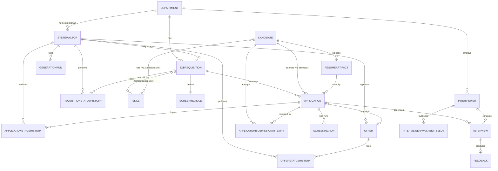

# Entity Relationships

**Revision 2** — corrected entity/table count, `SystemActor` and
`ApplicationSubmissionAttempt` added, `Application`'s PK relationship redrawn as
derived rather than independently assigned.

**Second verification pass** — adds `ScreeningRun` (resolves A-16), bringing the
total to 22 tables.

**Implementation-detail clarification pass** — `ScreeningRule` becomes
versioned/insert-only (§3); `ScreeningRun.screening_rule_id` becomes a direct FK.
Table count unchanged at 22 — see note below the cardinality table.

**Withdrawal/resubmission policy pass (this revision)** — §5 adds a note confirming
the Application↔ApplicationSubmissionAttempt relationship has no dependency on
`Application.stage`. No cardinality changed.

## 1. Full table inventory and corrected count

**12 mandated core entities** (verbatim from the brief — this list is exhaustive, not
"12 plus more mandated ones hiding elsewhere"):

1. Department
2. JobRequisition
3. Candidate
4. Application
5. ResumeArtifact
6. Skill
7. **CandidateSkill** — this is the Candidate↔Skill bridge table *and* one of the 12
   mandated entities simultaneously. It is listed once, here, as #7. Rev 1's
   entity-relationship document described it both as "one of the 12" and informally as
   "a bridge table" in prose, which could be misread as implying a 13th table — it does
   not. There is no separate, additional CandidateSkill-the-bridge beyond
   CandidateSkill-the-entity; they are the same table.
8. ScreeningRule
9. Interview
10. Interviewer
11. Feedback
12. Offer

**10 supporting tables**, each added for a specific, named reason — none are a
re-listing of anything already in the 12:

13. `JobRequisitionSkill` — bridge required by A-1 (required skills attach to the
    requisition, not the department)
14. `InterviewerAvailabilitySlot` — required by mandated capability 6 ("interviewer
    availability and scheduling"); without it there is no concept of "available" for
    the unavailable-interviewer anomaly to violate
15. `RequisitionStatusHistory` — immutable audit log, mandated capability 10
16. `ApplicationStageHistory` — immutable audit log, mandated capability 10
17. `OfferStatusHistory` — immutable audit log, mandated capability 10

(15–17 are "the three history tables" referred to elsewhere in these docs — this count
has stayed at exactly three across every revision. Screening history is **not** one
of them and never has been counted as a 4th: it was briefly a JSON field on
`Application` under Rev 2, and is now the dedicated `ScreeningRun` table under #22
below — a result-log, not a status-transition log, so it was never eligible to count
against this limit in either form. See §4a for the full reasoning.)

18. `AnomalyLabel` — isolated ground truth, brief §5/§6
19. `GenerationRun` — reproducibility checksum manifest, brief §6
20. `SystemActor` — **new in Rev 2** — synthetic actors behind every approval/audit
    record, replacing Rev 1's free-text actor fields (A-4)
21. `ApplicationSubmissionAttempt` — **new in Rev 2** — resolves the duplicate-
    application-ID conflict (PROJECT_SPEC §5); logs every submission event so that a
    repeat submission for the same `(candidate, requisition)` pair is preserved, not
    discarded, without ever requiring a second `Application` row with a colliding PK
22. `ScreeningRun` — **new, this verification pass** — resolves A-16; one immutable
    row per screening execution, giving every run a real, queryable primary key
    (`data_dictionary.md` §8b); see §4a below for why this isn't a 4th "history table"

**Total: 12 + 10 = 22 tables.** This number is used identically in
`PROJECT_SPEC.md` §4, `architecture.md` §7, and `implementation_plan.md` Phase 1 — if
you find a different count anywhere else in the docs, that's a bug to flag.

## 2. Diagram (Mermaid ER)



> Mermaid ERD syntax doesn't render bridge tables as boxes — `JobRequisitionSkill` and
> `CandidateSkill` are annotated as edge labels above and given full field tables in
> `data_dictionary.md` §4 and §7.

## 3. Cardinality summary (plain English)

| Parent | Relationship | Child | Cardinality | FK lives on |
|---|---|---|---|---|
| Department | has | JobRequisition | 1 : N | JobRequisition.department_id |
| Department | employs | Interviewer | 1 : N | Interviewer.department_id |
| Department | homes (optional) | SystemActor | 1 : N (nullable) | SystemActor.department_id |
| SystemActor | requests | JobRequisition | 1 : N | JobRequisition.requested_by_actor_id |
| SystemActor | performs | RequisitionStatusHistory | 1 : N | RequisitionStatusHistory.actor_id |
| SystemActor | performs | ApplicationStageHistory | 1 : N | ApplicationStageHistory.actor_id |
| SystemActor | performs | OfferStatusHistory | 1 : N | OfferStatusHistory.actor_id |
| SystemActor | approves | Offer | 1 : N (nullable until approved) | Offer.approved_by_actor_id |
| SystemActor | runs | GenerationRun | 1 : N | GenerationRun.generated_by_actor_id |
| JobRequisition | requires | Skill | M : N | bridge `JobRequisitionSkill` |
| JobRequisition | defines | ScreeningRule | **1 : N over time, exactly one `is_current=true`** (**changed, this pass** — was strict 1:1; `ScreeningRule` is now versioned/insert-only, same pattern as `ResumeArtifact.is_latest`) | ScreeningRule.requisition_id; partial unique index on `is_current` |
| ScreeningRule | versions | ScreeningRun | 1 : N, **direct FK** (**changed, this pass** — was "indirect, no direct FK") | `ScreeningRun.screening_rule_id` points at the exact `ScreeningRule` row used, permanently (reproducibility — `data_dictionary.md` §8b/§9, `business_rules.md` §4); `screening_rule_version` remains a denormalized display copy |
| JobRequisition | receives | Application | 1 : N | Application.requisition_id |
| JobRequisition | logs | RequisitionStatusHistory | 1 : N | RequisitionStatusHistory.requisition_id |
| Candidate | submits (via attempts) | Application | 1 : N | Application.candidate_id |
| Candidate | attempts | ApplicationSubmissionAttempt | 1 : N | ApplicationSubmissionAttempt.candidate_id |
| Candidate | uploads | ResumeArtifact | 1 : N | ResumeArtifact.candidate_id |
| Candidate | has | Skill | M : N | bridge `CandidateSkill` |
| ResumeArtifact | used by | Application | 1 : N | Application.resume_artifact_id |
| **Application** | **recorded by** | **ApplicationSubmissionAttempt** | **1 : N** | `ApplicationSubmissionAttempt.canonical_application_id` |
| **Application** | **has runs** | **ScreeningRun** | **1 : N** | `ScreeningRun.application_id`; `Application.latest_screening_run_id` points back at the current one |
| Application | generates | Interview | 1 : N | Interview.application_id |
| Application | may yield | Offer | 1 : 0..1 | Offer.application_id (unique) |
| Application | logs | ApplicationStageHistory | 1 : N | ApplicationStageHistory.application_id |
| Interviewer | conducts | Interview | 1 : N | Interview.interviewer_id |
| Interviewer | publishes | InterviewerAvailabilitySlot | 1 : N | InterviewerAvailabilitySlot.interviewer_id |
| Interview | produces | Feedback | 1 : 0..1 | Feedback.interview_id (unique) |
| Offer | logs | OfferStatusHistory | 1 : N | OfferStatusHistory.offer_id |

The bolded row is new in Rev 2 and is the mechanism behind the duplicate-application
fix — see §5 below. The two rows marked "changed, this pass" (`JobRequisition`
defines `ScreeningRule`, and `ScreeningRule` versions `ScreeningRun`) are cardinality
and FK-direction refinements to **existing** tables — the 22-table inventory is
unaffected; no table was added, removed, or renamed to make `ScreeningRule`
versioned, the same way `ScreeningRun` and `ResumeArtifact` didn't need a dedicated
history table for their own `is_latest` pattern.

## 4. Why `Interviewer` and `SystemActor` remain two separate entities

Both are "people" tables, which could look redundant. They are kept distinct
deliberately:
- `Interviewer` is one of the 12 mandated entities, has interview-specific fields
  (availability, conducted interviews), and is never an approver/requester/admin.
- `SystemActor` is a Rev 2 addition specifically for approval/audit attribution
  (brief's "approvals" and "audit history" capabilities), with its own role taxonomy
  that has nothing to do with interviewing.

Merging them would force every `Interviewer` row to also carry a `role` enum it
doesn't need, and would force `SystemActor` rows to carry interview-scheduling fields
they don't need. Keeping them separate is the smaller, more honest schema. (This
mirrors the same reasoning Rev 1 used to keep `ScreeningRule` separate from
`Application` — one table, one reason to exist.)

## 4a. Why `ScreeningRun` is not a 4th "history table" (new, this pass)

The second review round fixed the supporting-table count at **three** history tables
and that constraint is still honored — `ScreeningRun` doesn't count against it,
because it isn't the same *kind* of table. The three history tables
(`RequisitionStatusHistory`, `ApplicationStageHistory`, `OfferStatusHistory`) all
share one shape: a `from_status`/`to_status` pair logging a transition of some other
row's state machine. `ScreeningRun` has no from/to pair and logs no state transition
— it logs the result of a computation, once per execution. That's the same shape as
`Interview` (one row per interview round), `Feedback` (one row per completed
interview), and `ApplicationSubmissionAttempt` (one row per submission event) — none
of which were ever counted as "history tables" either, despite also being
append-only logs of repeatable events. `ScreeningRun` simply joins that existing
category; it doesn't create a new one, and it doesn't revisit the three-history-table
limit.

## 5. The duplicate-application fix, in relationship terms

Rev 1 treated `(candidate_id, requisition_id)` as a soft-unique pair on `Application`
itself, which meant a "duplicate application" anomaly had to be a second `Application`
row that broke that soft rule — survivable only because the PK wasn't derived from the
pair.

Rev 2 makes `Application.application_id` **a function of** `(requisition_id,
candidate_id)`. That turns "no duplicate applications for the same pair" from a
business rule you have to remember to check into a mathematical consequence of the PK
being a deterministic function with no collisions by construction. The relationship
that used to need a soft uniqueness check now needs none at all — `Application` simply
cannot have two rows for one pair, full stop.

What used to be representable as "two Application rows for one pair" is now
representable as "two `ApplicationSubmissionAttempt` rows pointing at the same
`Application`" — a completely ordinary 1:N relationship, no special-casing required.
Detection becomes a `GROUP BY (candidate_id, requisition_id) HAVING COUNT(*) > 1` over
`ApplicationSubmissionAttempt`, not over `Application`.

**Relationship clarification, this pass (withdrawal/resubmission, Option A
approved):** this 1:N relationship carries no dependency on `Application.stage` in
either direction — an `Application` can be `Withdrawn` while still accumulating new
`ApplicationSubmissionAttempt` rows via ordinary resubmission, exactly as it would in
any other stage. No cardinality changed; this note exists only because the question
was raised explicitly. Full policy: `business_rules.md` §3a.

## 6. Funnel consistency check (volumes from PROJECT_SPEC §5, unchanged by Rev 2)

```
JobRequisition      100
        │ avg 30 applications/req
        ▼
Application        3,000   (ApplicationSubmissionAttempt: 3,000 canonical + 15 duplicate = 3,015)
        │ ~14% proceed past screening to at least one interview
        ▼
Interview             600  (≈1.4 rounds per interviewed application → ~430 applications reach Interviewing)
        │ ~35% of interviewed applications receive an offer
        ▼
Offer                150
```
Unchanged from Rev 1 — the Rev 2 schema changes (derived Application ID, screening
history, SystemActor) do not alter the funnel math, only how duplicate submissions and
screening history are represented underneath it. Exact per-stage targets the generator
must hit: `business_rules.md` §1.

## 7. Referential-integrity direction

All foreign keys point from the "many"/"later-in-time" table to the "one"/"earlier"
table, keeping the generation order in `architecture.md` §4 a valid topological sort.
The one relationship that could look circular —
`ApplicationSubmissionAttempt.canonical_application_id → Application.application_id`
alongside the fact that an application's existence depends on at least one submission
attempt having happened — is **not** circular in the stored schema: `Application` is
generated first (its ID is derivable the instant `requisition_id` + `candidate_id` are
chosen, before any attempt row exists), and every `ApplicationSubmissionAttempt` row is
generated afterward, referencing it by a normal forward FK. `Application` itself holds
no FK back to any specific attempt. Full generation-order note: `architecture.md` §4.
